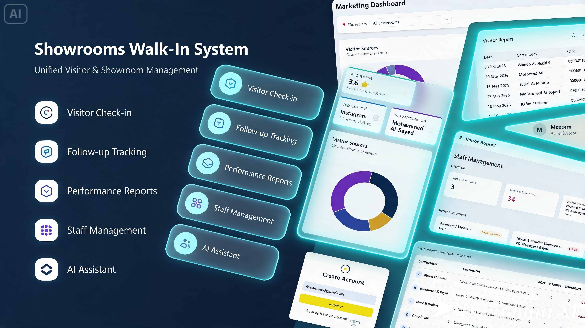

# Showrooms Walk-In System

A centralized web-based platform developed as a group project to manage showroom visitor check-ins, salesperson follow-ups, staff workloads, and showroom performance.

## Technologies Used

### **Backend**

* **Framework:** ASP.NET Core MVC
* **Language:** C#
* **Database:** Microsoft SQL Server
* **ORM:** Entity Framework Core (Database First)
* **Security:** BCrypt.Net (Password Hashing)
* **AI Integration:** Groq API (Models for real-time admin assistance)

### **Frontend**

* **HTML5 & CSS3**
* **Bootstrap**
* **JavaScript**

## Video Walkthroughs

### Visitor 

https://github.com/user-attachments/assets/57e3893a-d9ce-418c-a12b-c846fd6495c5

### Admin Dashboard

https://github.com/user-attachments/assets/fa63a6c4-c8a1-4efb-b57e-67bb2c3206dd

## Key Features

### Visitor
- Digital check-in form
- English and Arabic language support
- Star ratings and post-visit feedback

### Admin
- Daily, weekly, and monthly visitor analytics
- Searchable and filterable reports with pagination
- Missed follow-up tracking
- Soft-delete and restore functionality
- Marketing Page
- Salesperson workload monitoring
- AI assistant for operational insights

## My Contributions
- Admin registration and login
- Visitor analytics and reporting
- Search, filtering, and pagination
- Soft-delete and restore functionality
- Salesperson workload monitoring
- AI assistant integration

## Note

This repository contains project documentation and demonstration videos only; source code is not included.

The project was developed collaboratively as a group project.
